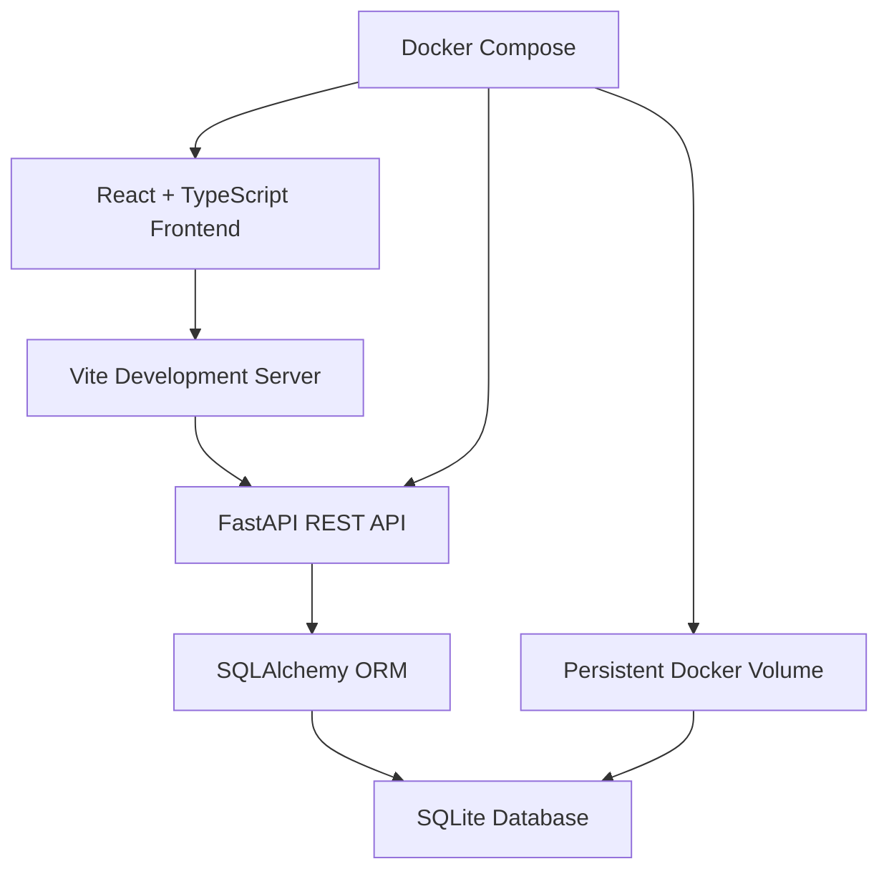
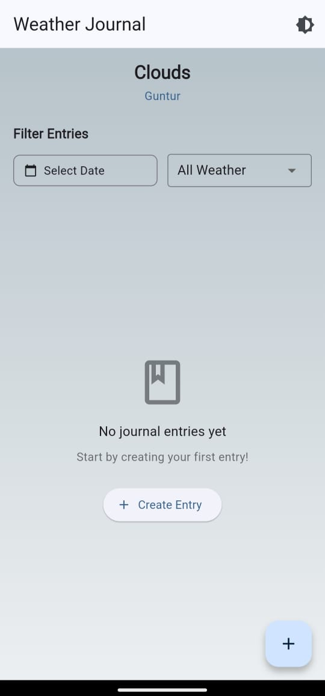
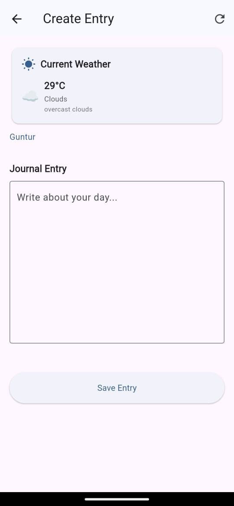
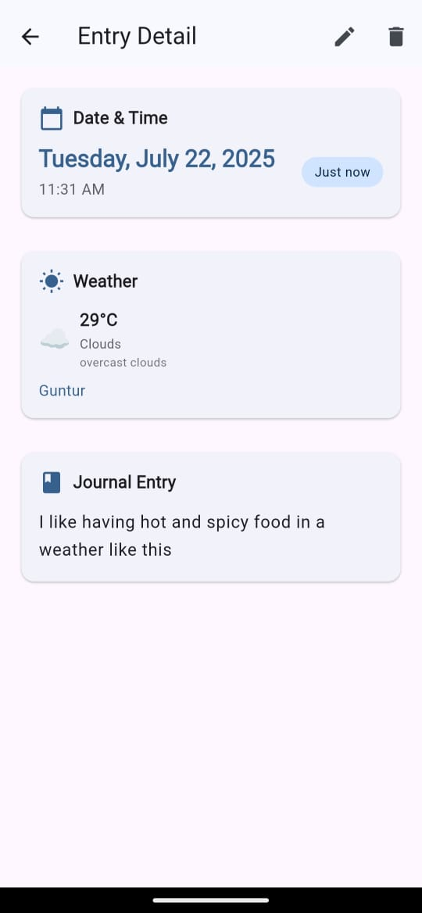

# Weather Journal App

A full-stack journaling application that combines a daily journal with weather information. This repository contains the original Flutter mobile application and an upgraded web application built with React, TypeScript, FastAPI, and SQLite.

The project demonstrates frontend development, REST API design, database persistence, automated testing, containerization, and continuous integration.

## Project Overview

The repository contains two applications:

- **Flutter application:** A mobile-focused weather journal with local storage, PIN authentication, live location-based weather, and theme support.
- **Full-stack web application:** A React dashboard backed by a FastAPI REST API, SQLAlchemy, and SQLite. The web application supports creating, viewing, editing, and deleting journal entries.

## Full-Stack Architecture



## Full-Stack Technology Stack

| Layer | Technologies |
|---|---|
| Frontend | React, TypeScript, Vite, CSS |
| Backend | Python, FastAPI, Pydantic |
| Database | SQLite, SQLAlchemy |
| Testing | pytest, ESLint, Vite production build |
| Deployment and development | Docker, Docker Compose |
| CI | GitHub Actions |

## Web Application Features

- Create, view, edit, and delete journal entries.
- Record entry titles, descriptions, moods, and weather selections.
- View recent journal entries in an interactive dashboard.
- Communicate with the backend through REST API endpoints.
- Persist journal entries in a SQLite database.
- Run the frontend and backend using Docker Compose.
- Store database files in a persistent Docker volume.
- Run backend tests and frontend quality checks through CI.

**Note:** Weather selections in the web dashboard are manually selected. The original Flutter application has the live, location-based weather functionality.

## Run the Full-Stack Application with Docker

### Prerequisites

- Git
- Docker Desktop with Docker Compose

### 1. Clone the repository

```bash
git clone https://github.com/premnadh/weather_journal_app.git
cd weather_journal_app
git checkout full-stack-upgrade
```

### 2. Start the application

```bash
docker compose up --build -d
```

### 3. Open the application

| Service | URL |
|---|---|
| Web dashboard | http://localhost:5173 |
| Backend health check | http://localhost:8000/health |
| Interactive API documentation | http://localhost:8000/docs |

### 4. Check container status and logs

```bash
docker compose ps
docker compose logs -f
```

To stop the application:

```bash
docker compose down
```

The database is stored in a named Docker volume. Stopping the application with `docker compose down` preserves that volume. Avoid `docker compose down -v` unless you intentionally want to remove the database volume and its stored data.

## Run the Backend Locally

From the repository root:

```bash
cd backend
python3 -m venv .venv
source .venv/bin/activate
pip install -r requirements.txt
```

Start the API from the repository root in a separate terminal:

```bash
cd ~/weather_journal_app
backend/.venv/bin/uvicorn app.main:app --app-dir backend --reload
```

The API will be available at http://127.0.0.1:8000.

## Run the Frontend Locally

In another terminal:

```bash
cd ~/weather_journal_app/frontend
npm ci
npm run dev
```

Open http://localhost:5173.

The Vite development server proxies API requests to the backend. If the backend runs on a different address, configure `VITE_API_PROXY_TARGET` accordingly.

## REST API Endpoints

| Method | Endpoint | Description |
|---|---|---|
| GET | `/health` | Check API health |
| GET | `/api/entries` | Retrieve journal entries |
| POST | `/api/entries` | Create a journal entry |
| PATCH | `/api/entries/{entry_id}` | Update a journal entry |
| DELETE | `/api/entries/{entry_id}` | Delete a journal entry |

Explore the available API schemas and try requests through http://localhost:8000/docs while the backend is running.

## Testing and Quality Checks

### Backend tests

Run the backend tests from the backend directory:

```bash
cd ~/weather_journal_app/backend
.venv/bin/python -m pytest tests/ -v
```

### Frontend checks

```bash
cd ~/weather_journal_app/frontend
npm run lint
npm run build
```

### Continuous integration

The GitHub Actions workflow in `.github/workflows/ci.yml` runs backend tests and frontend lint/build checks on configured pushes and pull requests.

Check the repository's **Actions** tab to see the latest workflow results.

---

# Original Flutter Application

The original Flutter application lets users record daily journal entries alongside live, location-based weather information.

## Flutter Technology Stack

- **Framework:** Flutter and Dart
- **Local storage:** Hive, SharedPreferences, Flutter Secure Storage
- **Weather API:** OpenWeatherMap
- **State management:** Provider

## Flutter Features

- PIN setup and session management, including auto-lock and session timeout.
- Create, edit, and delete journal entries.
- Fetch and display live, location-based weather information.
- Filter entries by date and weather.
- Journal list and detail views.
- Local data persistence using Hive.
- Error handling and loading indicators.
- Smooth navigation and transitions.
- Dark mode and weather-based themes.
- Unit and widget tests.

## Flutter Project Structure

```text
lib/
├── models/      # Journal and weather models
├── providers/   # Authentication, journal, and theme state
├── services/    # API, storage, and weather logic
├── screens/     # Application screens
├── widgets/     # Reusable UI components
└── utils/       # Constants and themes
```

## Run the Flutter Application

### 1. Install dependencies

Ensure Flutter is installed, then run:

```bash
flutter pub get
```

### 2. Configure the weather API

1. Get an API key from [OpenWeatherMap](https://openweathermap.org/api).
2. Configure the key in `lib/services/weather_service.dart` as required by the existing implementation.

Do not commit private API keys or other secrets to GitHub.

### 3. Run the app

```bash
flutter run
```

Flutter supports multiple platforms, depending on the project's configuration and installed toolchains.

### 4. Run Flutter tests

```bash
flutter test
```

## Original Flutter Screenshots

### Lock Screen (PIN)


### Home Screen



### Create Entry Screen



### Entry Detail Screen



## Build an Android APK

```bash
flutter build apk --release
```

The generated APK can be found in `build/app/outputs/flutter-apk/` when the build succeeds.

## Roadmap

Potential future improvements include:

- Add live weather integration to the web application.
- Add authentication and user-specific journals to the web application.
- Expand API integration tests and frontend component tests.
- Add deployment configuration for a hosted environment.

## License

This project is licensed under the MIT License.
